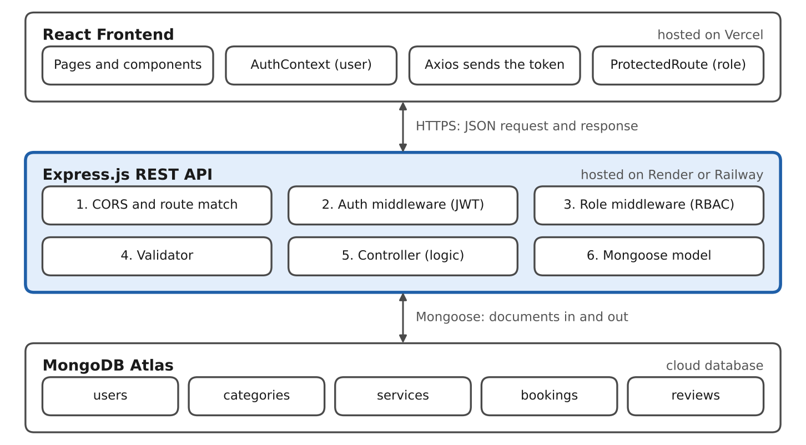
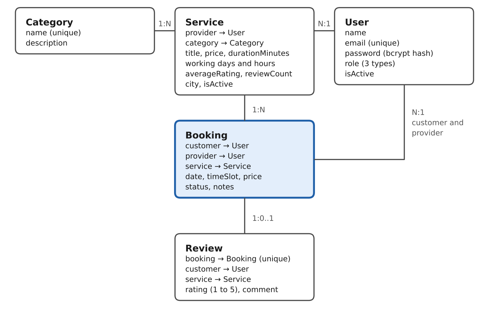
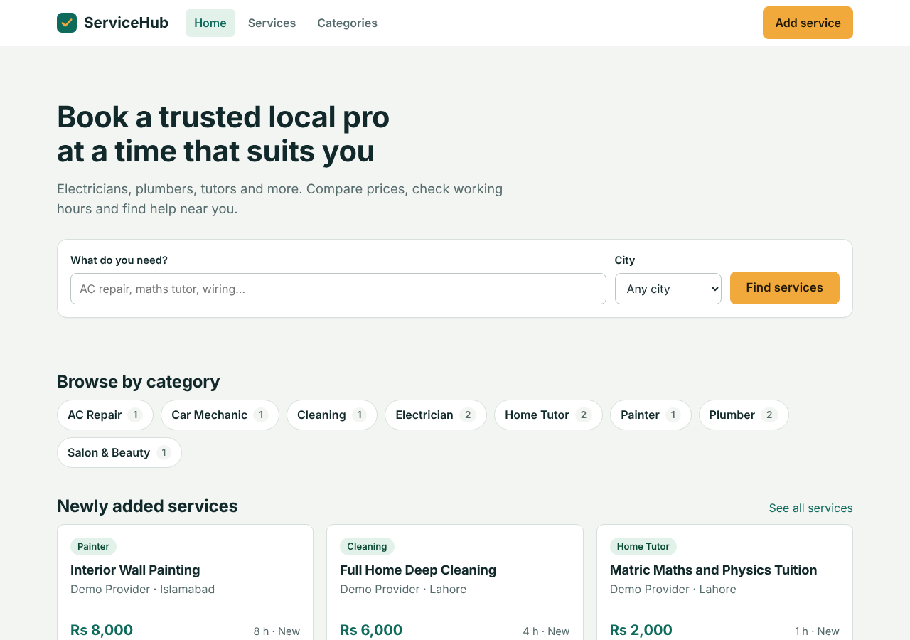
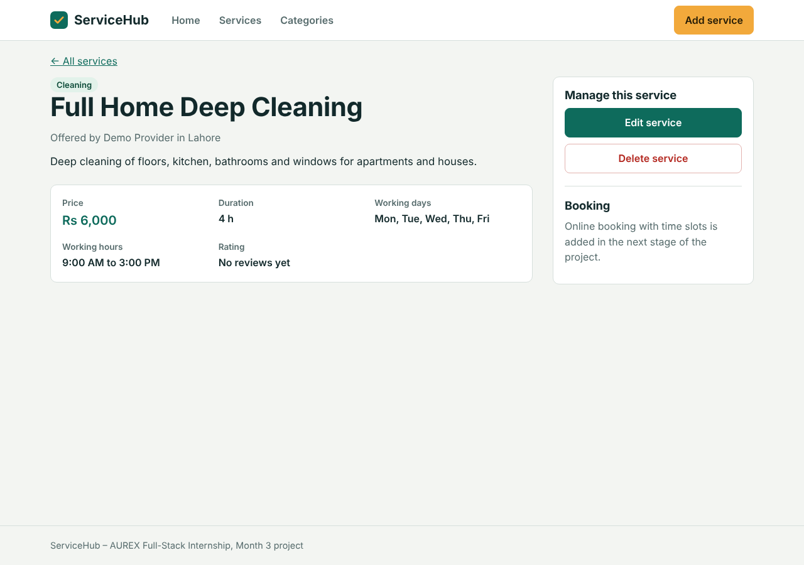
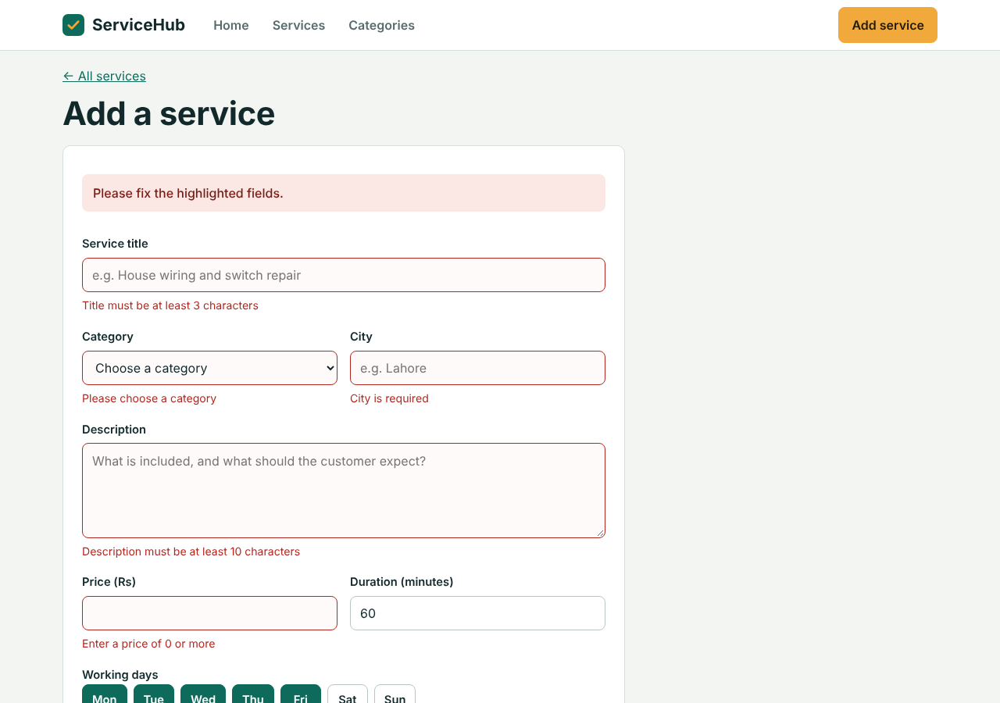
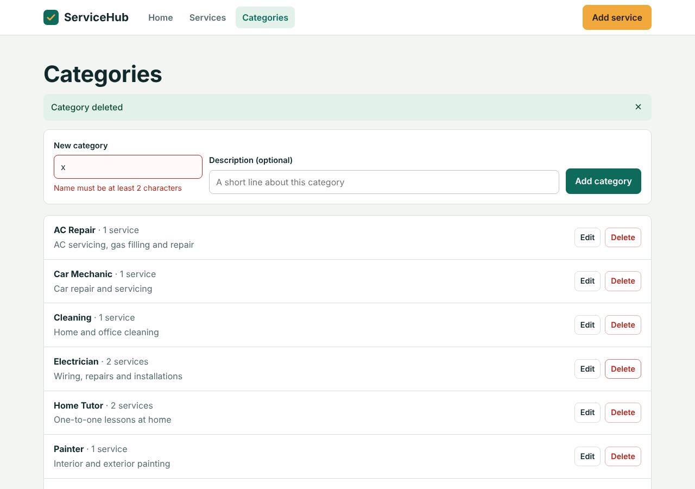

# ServiceHub – Local Service Booking Platform

A full-stack MERN (MongoDB, Express, React, Node.js) web application where customers discover and book local service providers (electrician, plumber, home tutor, salon, mechanic and similar) and providers manage their services and bookings.

Built as the Month 3 industry project of the **AUREX Full-Stack Engineering Internship**.

> **Project status:** Week 2 complete – the React frontend, Express API and MongoDB database are connected, with the service catalogue and category management working end to end. Authentication and booking logic come in Week 3.

---

## Table of Contents

1. [Problem Statement](#problem-statement)
2. [User Roles](#user-roles)
3. [Features](#features)
4. [Tech Stack](#tech-stack)
5. [System Architecture](#system-architecture)
6. [Database Design](#database-design)
7. [API Overview](#api-overview)
8. [Screenshots](#screenshots)
9. [Repository Structure](#repository-structure)
10. [Setup Instructions](#setup-instructions)
11. [Development Plan](#development-plan)
12. [Live Links](#live-links)
13. [Author](#author)

---

## Problem Statement

Most people find local service providers through word of mouth, WhatsApp groups or phone calls. Customers cannot easily compare services, prices and reviews. Time slots are agreed informally, so double bookings and no-shows are common. Providers have no single place to manage their schedule and build a reputation.

ServiceHub gives customers a searchable catalogue with real-time slot availability, gives providers a dashboard to manage services and booking requests, and gives admins control over the platform.

## User Roles

| Role | Description |
| --- | --- |
| Customer | Browses and searches services, books a time slot, cancels bookings, leaves reviews after completion |
| Provider | Creates and manages own services, sets working days and hours, confirms, rejects or completes booking requests |
| Admin | Manages users and categories, removes inappropriate content, views all bookings and statistics |

## Features

**Working now (Week 2)**

- Service catalogue with search, category, city and price filters, sorting and pagination
- Create, view, edit and delete services (full CRUD) with validation on the frontend and the backend
- Category management (add, edit, delete) with duplicate and in-use checks
- Loading, error, empty and success states throughout the interface
- All five database models, bcrypt password hashing in the User model, and a database-level double-booking guard
- Central error handling with one consistent JSON error format
- Seed script with demo data

**Coming next (Week 3 and 4)**

- Registration and login with JWT and role-based access control
- Slot-based booking with availability and booking status workflow
- Ratings and reviews
- Role-specific dashboards and admin statistics
- Postman test collection, deployment and final documentation

## Tech Stack

| Layer | Technology |
| --- | --- |
| Frontend | React, Vite, React Router, Axios |
| Backend | Node.js, Express |
| Database | MongoDB, Mongoose, MongoDB Atlas |
| Authentication | bcryptjs (hashing now), jsonwebtoken (Week 3) |
| Validation | express-validator and Mongoose schema validation |
| Testing | Postman (Week 3 and 4) |
| Deployment | Vercel (frontend), Render or Railway (backend) |

## System Architecture

The React frontend talks to the Express REST API over HTTPS using JSON. The API talks to MongoDB through Mongoose. Every request passes through CORS, validation and the controller before it reaches the database.



## Database Design

Five collections: **users**, **categories**, **services**, **bookings** and **reviews**.



Key design decisions:

- References (ObjectId) are used instead of embedding, because bookings and reviews grow without limit.
- The service price is copied into each booking, so later price changes do not affect old bookings.
- A unique partial index on bookings (provider, date, timeSlot) prevents double booking at database level.

## API Overview

All endpoints start with `/api`. Full details, validation rules and examples are in [`docs/API.md`](docs/API.md).

| Module | Endpoints | Status |
| --- | --- | --- |
| Health | `GET /health` | Done |
| Categories | `GET /categories`, `POST /categories`, `PUT /categories/:id`, `DELETE /categories/:id` | Done |
| Services | `GET /services`, `GET /services/cities`, `GET /services/:id`, `POST /services`, `PUT /services/:id`, `DELETE /services/:id` | Done |
| Auth, Users | register, login, profile, user management | Week 3 |
| Bookings, Reviews, Admin | booking workflow, slots, reviews, statistics | Week 3 |

## Screenshots

| Home | Service detail |
| --- | --- |
|  |  |

| Form validation | Categories |
| --- | --- |
|  |  |

## Repository Structure

```
servicehub-fullstack/
├── backend/
│   ├── config/         database connection
│   ├── controllers/    business logic (category, service)
│   ├── middleware/     validate, notFound, errorHandler
│   ├── models/         User, Category, Service, Booking, Review
│   ├── routes/         URL to controller mapping
│   ├── utils/          AppError, seed script, helpers
│   ├── app.js          Express app setup
│   └── server.js       starts the server
├── frontend/
│   └── src/
│       ├── components/ Navbar, ServiceCard, ServiceForm, Pagination ...
│       ├── pages/      Home, Services, ServiceDetail, Add/Edit, Categories
│       ├── hooks/      useFetch, useFlash
│       ├── services/   api.js (Axios)
│       └── utils/      formatting helpers
├── docs/               planning document, diagrams, API docs, screenshots
├── README.md
└── .gitignore
```

## Setup Instructions

**You need:** Node.js 22 LTS or newer (https://nodejs.org; 20.19 also works), Git, and a MongoDB database (MongoDB Atlas free tier or local MongoDB). See [`docs/MONGODB_ATLAS_GUIDE.md`](docs/MONGODB_ATLAS_GUIDE.md).

### 1. Backend

```bash
cd backend
npm install
cp .env.example .env        # on Windows: copy .env.example .env
```

Open `backend/.env` and set `MONGO_URI` to your own MongoDB connection string. Then:

```bash
npm run seed                # adds demo categories, services and users
npm run dev                 # starts the API on http://localhost:5000
```

Open http://localhost:5000/api/health. You should see `"ServiceHub API is running"`.

### 2. Frontend

Open a second terminal:

```bash
cd frontend
npm install
cp .env.example .env        # on Windows: copy .env.example .env
npm run dev                 # starts the app on http://localhost:5173
```

### Environment variables

Real values are never committed. `.env` is listed in `.gitignore`.

| File | Variable | Meaning |
| --- | --- | --- |
| backend/.env | `PORT` | API port (default 5000) |
| backend/.env | `MONGO_URI` | MongoDB connection string |
| backend/.env | `CLIENT_URL` | Frontend address allowed by CORS (default http://localhost:5173) |
| backend/.env | `NODE_ENV` | `development` or `production` |
| backend/.env | `SEED_PASSWORD` | Password for the demo accounts created by the seed script |
| frontend/.env | `VITE_API_URL` | Backend address (default http://localhost:5000/api) |

### Demo accounts

`npm run seed` creates three accounts (`admin@servicehub.test`, `provider@servicehub.test`, `customer@servicehub.test`) with the password from `SEED_PASSWORD` (default `Password123`). They are used for login from Week 3. **The seed script deletes existing data, so use it only on a development database.**

## Development Plan

| Week | Focus | Status |
| --- | --- | --- |
| Week 1 | Planning and architecture: requirements, diagrams, database schema, API list, UI flow, repository setup | Done |
| Week 2 | Full-stack core: Express server, MongoDB models, React app with routing and API integration | Done |
| Week 3 | Authentication, RBAC and booking business logic | Planned |
| Week 4 | Testing with Postman, deployment, final documentation and demo | Planned |

See [`docs/WEEK2_SUBMISSION.md`](docs/WEEK2_SUBMISSION.md) for the list of completed features and known issues.

## Live Links

| | URL |
| --- | --- |
| Frontend (Vercel) | Coming in Week 4 |
| Backend API (Render/Railway) | Coming in Week 4 |

## Author

**[Hafsa Mudassar]**
AUREX Full-Stack Engineering Intern
GitHub: [https://github.com/hafsa-cloud123]
